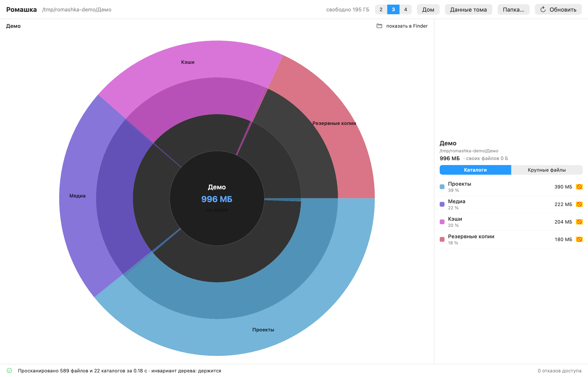
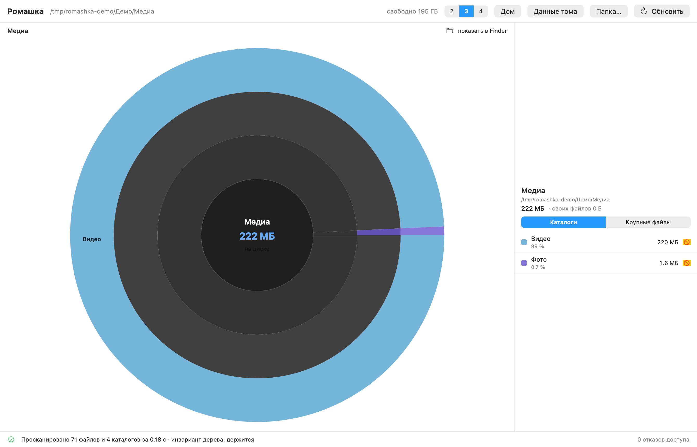
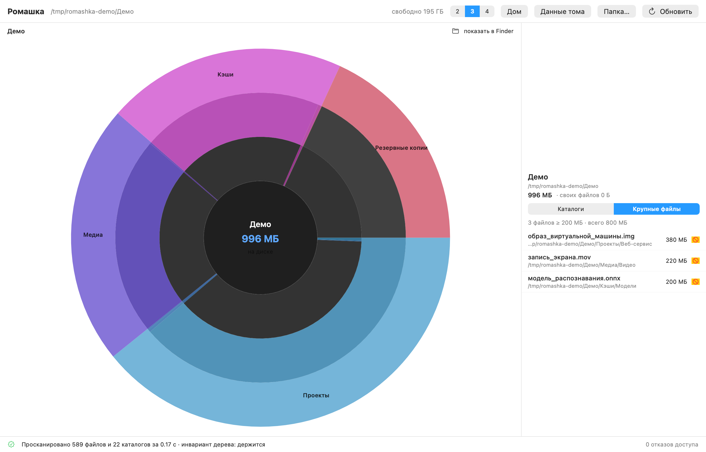

# Ромашка

**Приложение под macOS, которое показывает, чем занят диск.** Ромашка (sunburst) по
каталогам с иерархическим провалом: кольцо — уровень вложенности, угол — доля размера,
клик — провалиться внутрь. Удаление вы делаете сами в Finder: приложение **ничего не удаляет
и не изменяет**.

[](#установка)
[](#сборка-из-исходников)
[](#сборка-из-исходников)
[](LICENSE)
[](#установка)



## Зачем

Диск забит, а непонятно чем: `du` показывает список путей, Finder — «размер» не того рода,
а тяжёлая папка часто оказывается одним файлом (образ виртуальной машины, кэш датасетов,
архив логов). Нужен инструмент, который отвечает на два вопроса сразу: **где объём** и
**что именно можно снести**. Эта программа — он.

## Что умеет

- **Ромашка** по каталогам: угол сегмента — доля размера, кольца — глубина вложенности.
  Клик по сегменту — провал внутрь, клик в центр или `⌘↑` — наверх.
- **Наведение** показывает путь, размер и долю от родителя и подсвечивает всю ветку.
- **Список крупнейшего** справа: топ каталогов текущего уровня с долями.
- **Крупные файлы**: всё от 200 МБ отдельным списком — с путями и кнопкой «показать в Finder».
- **Живой обход**: ромашка рисуется с первых секунд и достраивается по ходу, обход можно отменить.
- **Права честно**: каталоги, закрытые системой (TCC), помечаются — приложение говорит,
  сколько их, и предлагает открыть настройки полного доступа к диску.
- **Ноль разрушительных операций**: в коде нет ни одного вызова удаления, перемещения или
  записи данных пользователя — только `NSWorkspace.activateFileViewerSelecting` (показать в Finder).

Провал внутрь — ромашка перестраивается вокруг выбранного каталога:



А это вкладка «Крупные файлы» — то, ради чего всё затевалось: тяжёлая папка часто
оказывается одним файлом.



## Установка

**Готовый образ** — в разделе [Releases](../../releases): `Romashka-1.0-universal.dmg`
(1.1 МБ, Apple Silicon и Intel, macOS 14+). Внутри приложение, ярлык «Applications» и
инструкция по установке.

Приложение подписано ад-хок (сертификата разработчика Apple нет), поэтому при первом запуске
Gatekeeper будет возражать. Один раз на машину:

1. правый клик по значку → **«Открыть»** → «Открыть»;
   на macOS 15+ этот путь убрали — тогда **Системные настройки → Конфиденциальность и
   безопасность → «Всё равно открыть»**;
2. либо в Терминале: `xattr -dr com.apple.quarantine /Applications/Romashka.app`.

Если передавать образ по внутренней шаре или `scp`, карантина нет вовсе — двойной клик работает сразу.

## Сборка из исходников

**Xcode не нужен.** Нужны только Command Line Tools и macOS 14+:

```bash
xcode-select --install                     # если ещё не установлены (дают clang++ и swiftc)
git clone https://github.com/DmitriyValetov/Romashka.git
cd Romashka
app/build.sh                               # ~15 секунд
open app/build/Romashka.app
```

`app/build.sh` собирает движок (`clang++`), интерфейс (`swiftc`) и склеивает оба среза
(`lipo`), затем упаковывает `.app` и подписывает ад-хок. На выходе — `app/build/Romashka.app`,
универсальный бинарник arm64 + x86_64. Проверено на чистом клоне: собирается и запускается.

Движок — C++ (`getattrlistbulk` + пул потоков), интерфейс — SwiftUI; мост между ними —
чистый C-заголовок `app/Engine/rk_engine.h`, никаких зависимостей и пакетных менеджеров.

**Чего требуют остальные скрипты**

| Скрипт | Что нужно | Что делает |
|---|---|---|
| `app/build.sh` | clang++, swiftc (Command Line Tools) | собирает `.app` |
| `tools/make_dmg.sh` | — | `dist/Romashka-1.0-universal.dmg` + `.sha256` |
| `bench/fastscan.cpp` | clang++ | CLI-прототип движка: `clang++ -O2 -std=c++17 -o bench/fastscan bench/fastscan.cpp` |
| `mockup/render.py` | Python 3 + Pillow | рисует двухпанельный макет из JSON сканирования |
| `tools/make_demo_assets.sh` | Pillow (сам соберёт `bench/fastscan`, если его нет) | демо-дерево + скриншоты + макет |
| `tools/make_icon.py` | Pillow + `iconutil` | иконка `.icns` |
| `tools/publish.sh` | `gh` (авторизованный) + Pillow | собирает и отправляет публичную копию репозитория |

```bash
pip3 install pillow        # только для макета, иконки и демо-материалов
```

## Как это работает

Скорость здесь — не деталь, а суть: инструмент, который думает минуту, никто не откроет второй раз.

- **`getattrlistbulk(2)` вместо `readdir` + `lstat`**: атрибуты каталога читаются пачкой,
  одним вызовом на каталог, а не вызовом на файл.
- **Пул потоков, но ровно 4** (по умолчанию): на 14 потоках обход **медленнее**, чем на одном —
  упирается в конкуренцию за общие структуры. Это замер, а не догадка (см. `docs/design.md`, § 4.3).
- **Считается занятое место** (`st_blocks`), а не логический размер: на тестовой машине разница
  756 ГБ против 1.5 ТБ. Finder в «Свойствах» показывает второе — отсюда вечное «почему размеры не сходятся».
- **Крупные файлы** собираются отдельно (`fstatat` только для файлов выше порога).
- **Живой снимок** дерева берётся раз в 150 мс и только по крупным узлам — рисовать 400 тысяч
  сегментов всё равно никто не станет.

## Замеры (MacBook, 14 ядер, APFS, 4 потока)

| Что обходили | Объектов | Занято | Время |
|---|---|---|---|
| `~/Library` | 343 тыс. | 141 ГБ | 2.4 с |
| Домашний каталог | 3.70 млн | 756 ГБ | **19.7 с** |
| Весь том данных | 4.48 млн | 819 ГБ | **24.0 с** |

Пик памяти — 109–134 МБ, провал по клику — 0.06 мс (замер раскладки по самым густым узлам).

## Ключи командной строки

У приложения два «безголовых» режима — ими и проверяется всё, что описано выше.

```bash
BIN=app/build/Romashka.app/Contents/MacOS/Romashka
```

| Ключ | Что делает |
|---|---|
| `--selftest [путь]` | обход без интерфейса: время, счётчики, **инвариант дерева**, крупные файлы, пик RSS. Код возврата 1, если инвариант нарушен |
| `--jobs N` | число потоков (по умолчанию 4 — быстрее всего, см. замеры) |
| `--big-mb N` | порог «крупного файла», по умолчанию 200 МБ |
| `--render out.png` | оффскрин-рендер всего окна в PNG — не нужен доступ к записи экрана |
| `--render … --path DIR` | что обходить |
| `--render … --focus A/B` | на каком каталоге открыться (цепочка от корня) |
| `--render … --live N` | снимок **во время** обхода: так проверяется «ромашка с первых секунд» |
| `--render … --files` | показать вкладку «Крупные файлы» |
| `--render … --size WxH` | размер картинки, по умолчанию 1340x860 |

Проект писался с проверками на каждом шаге, и они воспроизводимы:

```bash
$BIN --selftest ~ --jobs 4                 # обход дома: время, инвариант, крупные файлы, память
$BIN --render shot.png --path ~            # посмотреть, как выглядит интерфейс, без окон
$BIN --render live.png --live 5 --path ~   # снимок на 5-й секунде обхода
```

Главный инвариант — `size == own + Σ(детей)` для каждого узла: он проверяется после каждого обхода
и ловит именно те ошибки, которые дают тихо врущий интерфейс. На нём пойманы три реальных дефекта
движка: незакрытый узел при отказе доступа, отдача размера родителю до завершения внуков и
потеря вклада ребенка из-за неатомарного `+=`. Подробности — `docs/design.md`, § 4.4.

Точность сверена с `du` на пяти каталогах: расхождение ≤ 0.03 %.

## Если что-то не собирается

| Симптом | Причина и что делать |
|---|---|
| `xcrun: error: invalid active developer path` | не установлены Command Line Tools: `xcode-select --install` |
| `error: cannot find 'MainActor' in scope` и подобное | старый Swift (нужен 6.x, идёт с Command Line Tools на macOS 14+) |
| `ModuleNotFoundError: No module named 'PIL'` | это скрипты макета/иконки: `pip3 install pillow` |
| `killed: 9` при запуске скачанного приложения | карантин Gatekeeper: правый клик → «Открыть» либо `xattr -dr com.apple.quarantine /Applications/Romashka.app` |
| Пусто в «Крупные файлы», часть каталогов серая | нет полного доступа к диску — приложение пишет об этом оранжевой строкой |

## Ограничения

- **Клоны APFS и снапшоты Time Machine** посчитать нельзя: публичного API нет, блоки
  учитываются дважды — как и любым другим инструментом.
- **Даталесс-файлы iCloud** (файл есть, блоков нет) считаются нулём на диске.
- Без **полного доступа к диску** часть системных каталогов закрыта; приложение показывает
  это оранжевой строкой и не притворяется, что видит всё.
- Системный том (`/System`) и точки монтирования не обходятся: удалять там нечего.

## Скриншоты

Снимки в репозитории сделаны на **демонстрационном дереве** (`tools/make_demo_assets.sh`
создаёт его во временном каталоге и рендерит всё заново) — чтобы в публичный репозиторий
не попадали настоящие каталоги автора. Проверить на своём диске: `$BIN --render` или просто запустить приложение.

## Структура

```
app/          приложение: Engine/ (C++ движок и его C-API), Sources/ (SwiftUI), build.sh
bench/        прототип движка на C++ (CLI) — эталон замеров, с него всё началось
docs/         design.md (дизайн, замеры, обоснования), app.md (как пользоваться)
mockup/       отрисовка двухпанельного макета на Python
screenshots/  снимки интерфейса (демонстрационные данные)
tools/        иконка, упаковка DMG, генератор демо-данных, скрипт публикации
```

## Лицензия

MIT — см. [LICENSE](LICENSE).

---

### In English

**Romashka** is a tiny macOS disk-usage visualizer: a sunburst of your folders where the angle
is the size and a click drills inside. It never deletes anything — you do that in Finder.
The scan engine (`getattrlistbulk` + a 4-thread pool, written in C++ with a C API) walks
3.7 M objects / 756 GB in ~20 seconds, and the whole app builds with Command Line Tools only —
no Xcode. Screenshots in this repo are rendered on a synthetic demo tree.
Download the DMG from [Releases](../../releases); the app is ad-hoc signed, so the first launch
needs right-click → Open (or `xattr -dr com.apple.quarantine /Applications/Romashka.app`).
