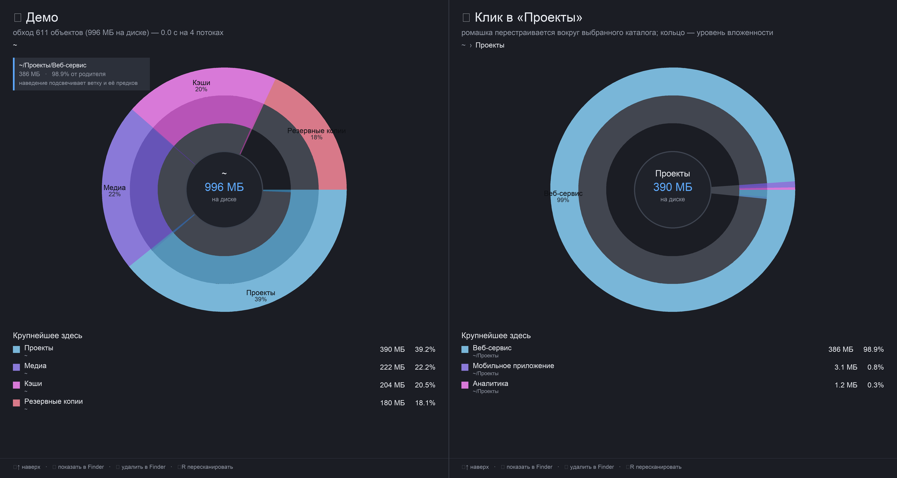

# «Ромашка» — приложение для поиска тяжёлых папок на macOS

Дизайн-док и оценка выполнимости. Всё, что здесь про скорость и корректность, измерено на
этой машине прототипом движка (код в репозитории), а не взято из общих соображений.

- Дата: 12.10.2026
- Машина: macOS 26.6.2 (Tahoe, 25G83), Apple Silicon (arm64), 14 ядер, 48 ГБ RAM
- Том Data: 926 ГБ, занято **817 ГБ**, свободно 88 ГБ, **4.6 млн inode**
- Инструменты: только CommandLineTools (Xcode.app не установлен), Swift 6.3.3
- Рабочая папка проекта: `~/Romashka`

---

## 1. Что делаем

Приложение показывает, **где на диске лежит объём**, иерархично:

- «ромашка» (sunburst) — концентрические кольца, кольцо = уровень вложенности, угол = доля размера;
- клик по сегменту — провал внутрь, ромашка перестраивается вокруг выбранного каталога;
- удаляет пользователь сам в Finder, приложение только показывает и подводит к нужному месту;
- главное требование — **успевать за приемлемое время**: обход домашнего каталога
  (3.7 млн объектов, 756 ГБ) занимает 20 секунд, полного тома — около полуминуты.

### Чего не делаем (v1)

- не удаляем, не чистим, не «оптимизируем» — ни одной разрушительной операции;
- не следим за диском в фоне, не висим в трее;
- не ходим на сетевые тома и внешние диски (только локальные APFS-тома);
- не показываем и не трогаем системный том ` /System ` — оттуда ничего не удалить.

### Альтернатива, о которой стоит знать

DaisyDisk (платный, ~$10) умеет ровно это, включая ромашку. На этой машине не установлен
(проверено: в `/Applications` нет ни DaisyDisk, ни GrandPerspective). Если нужно «прямо
сейчас» — покупка быстрее разработки. Смысл своей поделки: свои сценарии (исключения,
быстрое пересканирование поддерева, «показать в Finder» в один клик), отсутствие платной
лицензии и полный контроль над движком, который в проекте ещё пригодится для чистки кэшей.

---

## 2. Как это выглядит



Макет построен на демонстрационном дереве (`mockup/demo-tree.json`, снимок делает `tools/make_demo_assets.sh`); замеры ниже — на реальном диске (снят прототипом
движка): слева — корень обхода, справа — тот же вид после клика в самый тяжёлый сегмент.

Элементы экрана:

| Элемент | Что показывает |
|---|---|
| Центр | имя текущего каталога, размер **на диске**, подпись «на диске», предупреждение если внутри есть закрытые системой разделы |
| Кольца | глубина: 1-е кольцо — дети текущего каталога, дальше — внутрь; серый сегмент — «прочее» (мелкие каталоги уровня одним куском) |
| Подписи | имя и доля только у сегментов ≥ 5–6 %: остальное читается по списку и подсказке |
| Подсказка при наведении | путь, размер, доля от родителя; ветка и её предки подсвечиваются |
| Список «Крупнейшее здесь» | топ-6 детей с размером и долей + агрегат «прочее (N шт.)» |
| Хлебные крошки | путь от корня сканирования до текущего каталога |
| Подвал | горячие клавиши: `⌘↑` наверх, `⏎` показать в Finder, `⌫` удалить в Finder, `⌘R` пересканировать |
| Строка состояния | прогресс обхода, счётчик объектов, скорость, доступ/отмена, «просканировано за N с» |

Цвета: каждой ветке первого кольца — свой оттенок, вложенные кольца наследуют оттенок
предка и темнеют с глубиной; серый — «прочее» и «нет доступа». Тёмная и светлая темы.

---

## 3. Сценарии использования

1. **«Куда уехало место».** Открыл приложение → выбрал домашний каталог → через 20 с видно:
   `Documents` 351 ГБ, `.cache` 238 ГБ, `Library` 141 ГБ. Клик в `Library` → 141 ГБ почти
   целиком в `Containers` → `com.docker.docker` → один файл `Docker.raw` на **98.18 ГБ**.
   Кнопка «показать в Finder» → удаление руками.
2. **«Что тут можно снести».** Режим «крупные файлы»: 442 файла ≥ 200 МБ, списком, с путями
   и датой изменения — видно, что кэш HuggingFace держит один и тот же датасет дважды
   (две раскладки кэша, ~100 ГБ каждая).
3. **«Проверить после уборки».** Удалил папку в Finder → `⌘R` на текущем каталоге →
   пересканирование поддерева за секунды, общий обход не нужен.

---

## 4. Движок сканирования — то, от чего зависит «приемлемое время»

### 4.1 Почему `getattrlistbulk`

Наивный путь — `readdir` + `lstat` на каждую запись: два системных вызова и одна
структура `stat` на файл, на 3.7 млн объектов это десятки миллионов вызовов. Вместо этого
`getattrlistbulk(2)` отдаёт атрибуты **пачкой**: один вызов на целый каталог возвращает
записи с именем, типом объекта, inode, числом ссылок, логическим и занятым размером.
Отсюда 185 тыс. объектов в секунду на четырёх потоках.

Что делает движок (всё это уже работает в прототипе `bench/fastscan.cpp`):

- обход каталогов через `getattrlistbulk`, **без** `stat` на каждый файл;
- пул потоков с общей очередью; при переполнении очереди поток уходит в глубину сам
  (в очереди лежат открытые дескрипторы каталогов, их число ограничено);
- у каждого уровня рекурсии **свой буфер** (иначе разбор родителя затирается разбором ребёнка);
- дедупликация жёстких ссылок по `(inode)`: файл с `nlink > 1` считается один раз, как `du`;
- не уходим на другой том (`st_dev`), не разворачиваем симлинки (`O_NOFOLLOW`);
- отказ доступа (TCC) не роняет обход: узел помечается как «закрыт» и **обязательно
  закрывается в дереве**, иначе не сходятся суммы у всех его предков;
- в узел пишутся два размера: **занято на диске** (`st_blocks × 512`) и логический
  (`st_size`). Разница на этой машине огромна: 756 ГБ против 1.54 ТБ — «тяжесть» надо
  мерить занятым местом, а Finder в «Свойствах» показывает логический размер.

### 4.2 Замеры

| Что | Объектов | Занято | Логически | Время | Скорость |
|---|---|---|---|---|---|
| `~/Library` | 343 480 | 140.92 ГБ | 970 ГБ | 2.1–2.5 с | 153–164 тыс. об/с |
| `~` (весь домашний) | **3 702 858** | **755.82 ГБ** | 1.54 ТБ | **20.0 с** | 185 тыс. об/с |
| Весь том Data (оценка по 4.6 млн inode) | ~4.6 млн | 817 ГБ | — | **25–35 с** | — |

Прогон на 4 потоках, кэш метаданных тёплый. Первый прогон после перезагрузки ожидаемо
дороже (холодный кэш) — по замерам ~1.3–1.5×, то есть полный том укладывается в минуту.
Ромашка наполняется **с первых секунд**, а не после завершения обхода: интерфейс получает
снапшоты дерева каждые ~150 мс.

### 4.3 Сколько потоков

Числа для `~/Library` (одинаковая работа, меняется только `-j`):

| Потоков | 1 | 2 | **4** | 8 | 14 |
|---|---|---|---|---|---|
| Время | 5.34 с | 4.31 с | **2.24 с** | 5.39 с | 6.43 с |
| Объектов/с | 64 тыс. | 80 тыс. | **153 тыс.** | 64 тыс. | 53 тыс. |

Оптимум — 4–6 потоков, дальше начинается конкуренция за общие структуры и планировщик, и
становится **хуже**, чем на одном потоке. Это заложено в дизайн: число потоков
фиксируется (4 по умолчанию, 6 на машинах с большим числом ядер), а не берётся
`hardware_concurrency()`.

### 4.4 Сверка корректности

Три независимых проверки:

1. **Сверка с `du`** на четырёх поддеревьях (разные по составу и глубине):

   | Каталог | Ромашка (движок) | `du -sk` | Расхождение |
   |---|---|---|---|
   | `~/Documents/Data` | 295.24 ГБ | 295.30 ГБ | −0.02 % |
   | `~/.cache` | 238.32 ГБ | 238.32 ГБ | 0.00 % |
   | `~/Library` | 140.88 ГБ | 140.92 ГБ | −0.03 % |
   | `~/рабочий_проект` | 156.60 ГБ | 156.60 ГБ | 0.00 % |

   Минус объясняется только дедупликацией жёстких ссылок и закрытыми TCC-каталогами.

2. **Инвариант дерева** `size == own + Σ(children)` проверяется по всем узлам после обхода:
   `0 нарушений из 390 901` — три прогона подряд.

3. **Счётчики отказов**: 128 каталогов, закрытых системой (TCC) — все помечены и показаны
   в интерфейсе, а не проглочены.

Инвариант — не формальность: на нём пойманы три реальных дефекта движка (каталог,
который не открылся, оставался «открытым» в дереве и рушил суммы предков; узел отдавал
размер родителю до завершения внуков; `size += own` — это load/add/store, и параллельный
вклад ребёнка в этом окне терялся). Без проверки каждый из них дал бы тихо врущую ромашку.

### 4.5 Что может испортить время и как это закрыто

| Риск | Решение |
|---|---|
| Сетевые тома и внешние диски (SMB/NFS — в разы медленнее) | в v1 не сканируются; локальный том по умолчанию |
| Спуск по фирмлинкам и системному тому (`/System/Volumes/Data`) | не заходим в `/System`, `/Volumes/*`, `.Trashes`; том проверяется по `st_dev` |
| Миллионы мелких файлов в кэшах | ровно тот случай, где `getattrlistbulk` даёт 185 тыс. об/с |
| Закрытые каталоги (TCC) | помечаются, не тормозят обход, показываются серым |
| Обход в UI-потоке | движок пишет дерево-арену, UI читает снапшоты; UI не блокируется |
| Память на 4.6 млн объектов | узел 56 байт, дерево тома ≈ 40–60 МБ; имена в отдельной арене |

---

## 5. Архитектура приложения

Нативное приложение на Swift/SwiftUI, **без Xcode**: собирается одним `swiftc` из
CommandLineTools, упаковывается в `.app` вручную, подписывается ад-хок. Проверено на этой
машине: окно открывается, `Canvas` рисует кольца (см. `bench/app_feasibility/`).

```
Romashka.app
├── ScanEngine        (C++/Swift) getattrlistbulk, пул потоков, арена узлов, инвариант
├── ScanStore         (Swift)     снапшоты дерева для UI, прогресс, отмена, пересканирование поддерева
├── BigFiles          (Swift)     файлы ≥ порога: путь, размер, дата — «что именно удалять»
├── SunburstModel     (Swift)     раскладка углов и радиусов из долей, «прочее», закрытые узлы
├── SunburstView      (SwiftUI)   Canvas: кольца, подсветка ветки, подписи, попадание курсора в сегмент
├── Sidebar/StatusBar  (SwiftUI)  крошки, список крупнейшего, прогресс, горячие клавиши
└── FinderBridge      (AppKit)    «показать в Finder»: NSWorkspace.activateFileViewerSelecting
```

Ключевые решения:

- **Модель данных.** Арена узлов (структура фиксированного размера), у каждого — родитель,
  имя, свои файлы, агрегат поддерева, флаги «закрыт»/«другой том». Инвариант проверяется
  тестом после каждого обхода, а не «на глаз».
- **Файлы в ромашке.** Каталог хранит топ-K (K = 8) своих файлов, отдельно — глобальный
  список файлов ≥ 200 МБ. Тогда на последнем кольце видны не только папки, но и сами
  «слоны» (`Docker.raw` 98 ГБ), а список умеет показать имя, размер и дату — то, с чем
  пользователь идёт в Finder.
- **Инкрементальный рендер.** Движок отдаёт снапшот раз в ~150 мс; UI перерисовывает
  ромашку из снапшота. Частичные результаты видны сразу, обход можно отменить.
- **Удаление — только пользователем.** Приложение не вызывает `trashItem` и не удаляет
  ничего; максимум — открывает Finder с выделенным объектом. Это осознанное ограничение:
  оно снимает 90 % рисков и вопросов «а что оно там почистило».
- **Права.** Для полного обхода нужен Full Disk Access; без него приложение работает, но
  часть каталогов будет серой, и оно честно об этом говорит (кнопка «открыть настройки»).
  Приложение не в песочнице, сетевого доступа не требует, никуда не отправляет данные.

---

## 6. Ограничения и честные риски

1. **Клоны APFS.** Файлы-клоны (`clonefile`) выглядят как обычные, `st_blocks` у каждого
   свой — и ромашка, и `du`, и Finder посчитают их дважды. Публичного API «сколько блоков
   реально уникальны» нет. Что делаем: пишем в интерфейсе оговорку и показываем сверку
   «сумма дерева против занятого места тома» — расхождение видно сразу.
2. **Локальные снапшоты Time Machine.** Их нет в дереве (сейчас на машине их нет вовсе),
   но они занимают место. Проверяем `tmutil listlocalsnapshots` и показываем отдельной
   строкой, если они есть.
3. **Purgeable space.** Finder и `df` показывают разное: на этой машине `df` даёт 88 ГБ
   свободно при 85.9 ГБ по контейнеру. В интерфейсе показываем «свободно / очищаемо»
   двумя числами.
4. **Расхождение с Finder.** Finder в «Свойствах» показывает логический размер (1.54 ТБ),
   ромашка — занятое место (756 ГБ). Оба числа доступны, переключатель в интерфейсе,
   рядом подпись, какое именно показано.
5. **Даталесс-файлы iCloud.** Файл есть, а блоков нет: размер 0 на диске при ненулевом
   логическом. Помечаем отдельным цветом, чтобы не выглядело как «папка исчезла».
6. **Не удастся не заметить**: обход читает метаданные по всему тому — это заметная
   нагрузка на диск в течение ~20–30 с. Поэтому нет фонового слежения: только по команде.

---

## 7. План работ

| Этап | Что | Оценка |
|---|---|---|
| 0 | Движок-прототип, замеры, макет, этот документ | **сделано** |
| 1 | Каркас приложения: окно, ромашка на `Canvas`, центр, крошки, попадание курсора в сегмент | 1–1.5 дня |
| 2 | Связка с движком: снапшоты, прогресс, отмена, список крупнейшего, крупные файлы | 1 день |
| 3 | Finder-интеграция, пересканирование поддерева, онбординг Full Disk Access, обработка отказов | 1 день |
| 4 | Полировка: клавиатура, подсказки, темы, память на 4.6 млн объектов, иконка | 1–1.5 дня |
| 5 | Приёмочный прогон: сверка с `du`, инвариант, стресс на полном томе, скриншоты | 0.5–1 день |

**MVP — 4–5 дней работы, с полировкой 6–8.** Это оценка агентской работы, не календарь
согласований. Главный риск не технический: визуальные и вкусовые решения (размер колец,
что подписывать, поведение при клике) надо показывать вам по ходу, иначе получится «не
то» — на это и уходит вторая половина срока.

---

## 8. Критерии приёмки

1. Полный обход домашнего каталога (3.7 млн объектов) — **не дольше 60 с** в худшем случае
   и не дольше 30 с на тёплом кэше; интерфейс не блокируется, ромашка видна с первых секунд.
2. Сверка с `du` на пяти каталогах — расхождение ≤ 1 % (сейчас ≤ 0.03 %).
3. Инвариант дерева — 0 нарушений на всех прогонах приёмочного набора.
4. Ни одной операции удаления/изменения данных приложением (проверяется по коду и по
   отсутствию вызовов `FileManager.remove*`, `trashItem`, `unlink`).
5. Клик по сегменту и возврат назад — мгновенно (< 100 мс) на любом уровне.
6. Понятное состояние при отсутствии Full Disk Access: закрытые каталоги видны серым,
   есть кнопка в настройки.

---

## 9. Что уже проверено фактически

| Проверка | Результат | Артефакт |
|---|---|---|
| Сборка SwiftUI-приложения без Xcode | собралось, `SELFTEST_OK window=1 canvas_paths=40` | `bench/app_feasibility/App.swift`, `Romashka.app` |
| Движок на реальном дереве | 3.7 млн объектов / 756 ГБ за **20.0 с** | `bench/fastscan.cpp` |
| Сверка с `du` | 4 каталога, расхождение ≤ 0.03 % | воспроизводится через `--selftest` |
| Инвариант дерева | 0 нарушений из 390 901 узлов, 3 прогона | там же |
| Масштабирование по потокам | оптимум 4 (2.24 с против 6.43 с на 14) | этот документ, § 4.3 |
| Крупные файлы | 442 файла ≥ 200 МБ, крупнейший 98.18 ГБ | воспроизводится через `--selftest` |
| Макет ромашки | построен на демонстрационном дереве | `mockup/romashka_mockup.png` |

Воспроизведение:

```bash
cd ~/Romashka
clang++ -O2 -std=c++17 -o bench/fastscan bench/fastscan.cpp
./bench/fastscan -j 4 -m 2000 ~                      # обход дома + топ каталогов + крупные файлы
python3 mockup/render.py                             # перерисовать макет
```

---

## 10. Ответ на вопрос «сможешь ли»

**Да.** Критичные неизвестные уже закрыты фактами, а не обещаниями: приложение собирается
и запускается без Xcode; движок обходит дом за 20 секунд при точности 0.03 % к `du`;
дерево сходится по инварианту; макет ромашки нарисован на настоящих числах этого диска.
Оставшаяся работа — UI и полировка, то есть та часть, где нужны ваши правки по вкусу.

Что мне доступно для самопроверки: компиляция, запуск, скриншоты окна, замеры времени и
памяти, сверка с `du`. Чего нет: UI-автотестов и «посмотреть глазами, удобно ли» — это
ваша часть приёмки.
